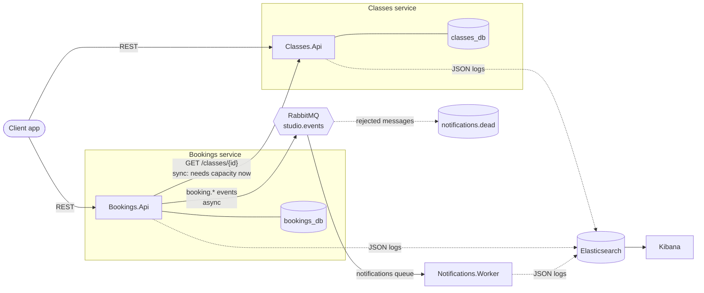

# Studio Booking

A class-booking backend for a fitness studio, built as three .NET 8 services that talk over HTTP and RabbitMQ, with structured logs searchable in Kibana.

It handles the parts of booking that are easy to get wrong: a class filling up while two people grab the last spot, a waitlist that promotes the right person when someone cancels, late-cancel rules, and telling clients what happened without the booking flow waiting on email.


## Architecture



| Service | Owns | Responsibilities |
|---|---|---|
| **Classes.Api** | `classes_db` | The schedule: class times, instructors, capacity |
| **Bookings.Api** | `bookings_db` | Booking, cancelling, waitlists, rosters. Publishes events |
| **Notifications.Worker** | nothing persistent | Consumes events and sends client messages (simulated) |

### Why it's split this way

- **Database per service.** Each service has the connection string for its own database only. Bookings can't join against the classes table, so it has to ask the Classes API. That keeps the schedule's rules in one place and lets each service change its schema independently.
- **Sync where the answer is needed now, async where it isn't.** A booking decision needs the class's current capacity and start time, so Bookings calls Classes over HTTP (3 second timeout, one retry, 503 if Classes is down). Sending a confirmation is not on the critical path, so it goes through RabbitMQ. If Notifications is down, bookings still work and messages wait in the queue.
- **A topic exchange, not a direct queue.** Bookings publishes `booking.confirmed`, `booking.waitlisted`, `booking.cancelled` and `booking.promoted` to an exchange. A future billing service (late-cancel fees) or analytics service can bind its own queue without any change to Bookings.

## The booking rules

All the rules live in `StudioBooking.Domain/ClassRoster.cs`, which has no I/O, so they are covered by fast unit tests:

- A booking is **Confirmed** while spots remain, otherwise **Waitlisted** with a position.
- A client can hold only one active booking or waitlist spot per class.
- No booking after a class starts.
- Cancelling a confirmed booking **promotes the first person on the waitlist** (first come, first served by booking time, regardless of the order rows come back from the database).
- Cancelling inside **12 hours** of the class is flagged as a late cancel.
- No promotion after the class has started.

## Handling concurrency

If two clients book the last spot at the same moment, both requests could read "1 spot left" and both succeed. To prevent that, every read-decide-write on a class roster runs inside `IBookingStore.WithClassLockAsync`:

- **Postgres:** a transaction with `pg_advisory_xact_lock(class key)`. Requests for the same class take turns; different classes run in parallel. The lock releases on commit or rollback, so it can't leak.
- **Backup:** a partial unique index on `(class_id, client_id) WHERE status <> 'Cancelled'` makes double-booking impossible at the database level even if the code had a bug.

`scripts/race.sh` fires 25 simultaneous booking requests at a class with 3 spots and checks that exactly 3 are confirmed. It runs in CI against the real Postgres stack.

## Reliability choices in messaging

- **Persistent messages and durable queues** survive a broker restart.
- **Manual acks**: a message is acknowledged only after it's handled.
- **Dead-letter queue**: a message that can't be parsed or handled is rejected to `notifications.dead` instead of retrying forever and blocking the queue.
- **Idempotent consumer**: RabbitMQ delivers at least once, so the same event can arrive twice. The handler remembers recent event IDs and skips repeats.
- **Readiness**: the Notifications `/health` endpoint stays unhealthy until its queue is declared and bound, so nothing publishes into an exchange with no queue behind it.

## Observability

Every service writes JSON logs (`Logging__Format=json` in containers) with the same fields:

- **CorrelationId**: taken from the `X-Correlation-Id` header or generated, returned in the response, forwarded on HTTP calls to Classes, and carried inside every event. Searching one ID in Kibana shows a booking's path through all three services.
- **Request timing**: one line per request with `Route` (the template, like `/bookings/{id}`, not the raw path), `StatusCode` and `ElapsedMs`.
- **W3C trace context** (TraceId) is propagated automatically by .NET's HttpClient.

Filebeat collects container logs and ships them to Elasticsearch; Kibana sits on top.

**Setting up Kibana** (after starting with the observability profile and running the demo):

1. Open http://localhost:5601, go to *Stack Management > Data Views*, create one for `studio-logs-*`.
2. In *Discover*, try `app.Scopes.CorrelationId : "demo-run"` to follow the demo across services, or `app.LogLevel : "Error"`.
3. In *Lens*, chart the median of `app.State.ElapsedMs` over time, broken down by `app.State.Route`, and a count of `app.State.StatusCode >= 500`.

## Running it

### With Docker (Postgres, RabbitMQ, all three services)

```bash
docker compose up --build
# in a second terminal, once the services are up:
PORTS=docker ./scripts/demo.sh
PORTS=docker ./scripts/race.sh
```

Add Elasticsearch, Kibana and Filebeat (needs about 2 GB of free memory):

```bash
docker compose --profile observability up --build
```

| URL | What |
|---|---|
| http://localhost:8081/classes | Classes API |
| http://localhost:8082/bookings | Bookings API |
| http://localhost:8083/notifications | Messages "sent" to clients |
| http://localhost:15672 | RabbitMQ UI (guest / guest): watch the queues and the dead-letter queue |
| http://localhost:5601 | Kibana |

### Without Docker

Each service falls back to in-memory storage, and Bookings posts events straight to Notifications over HTTP instead of RabbitMQ. Good for quick iteration, not for testing the queue behavior.

```bash
dotnet run --project src/Classes.Api        # :5101
dotnet run --project src/Bookings.Api       # :5102
dotnet run --project src/Notifications.Worker   # :5103
./scripts/demo.sh
```

## API

| Method | Path | Notes |
|---|---|---|
| GET | `/classes` | Upcoming classes (Classes.Api) |
| GET | `/classes/{id}` | One class |
| POST | `/classes` | `{ name, instructor, startsAt, durationMinutes, capacity }`, validated |
| POST | `/bookings` | `{ classId, clientId }` → 201 Confirmed or Waitlisted, 409 if already booked or started, 404 unknown class, 503 if Classes is down |
| DELETE | `/bookings/{id}` | Cancels; response includes who was promoted, if anyone |
| GET | `/bookings/{id}` | One booking |
| GET | `/bookings?clientId=` | A client's bookings |
| GET | `/classes/{id}/roster` | Confirmed list, waitlist in order, spots left (Bookings.Api) |
| GET | `/notifications?clientId=` | Recent messages (Notifications.Worker) |

Errors use RFC 7807 problem details. Every service exposes `/health`.

## Tests and CI

```bash
dotnet test
```

Unit tests cover the booking rules (capacity, waitlist order, double-booking, late cancel, promotion edge cases). The GitHub Actions workflow builds and tests, then starts the full Docker stack and runs `demo.sh`, `race.sh`, and a check that a waitlist-promotion message made it through RabbitMQ.

## Project layout

```
src/
  StudioBooking.Domain/          booking rules, no dependencies
  StudioBooking.Contracts/       event and DTO records shared between services
  StudioBooking.ServiceDefaults/ logging, correlation IDs, timing, health
  Classes.Api/
  Bookings.Api/
  Notifications.Worker/
tests/StudioBooking.Domain.Tests/
deploy/                          Postgres init, Filebeat config
scripts/                         demo.sh, race.sh
```

## What I'd do next

- **Transactional outbox.** Right now the booking is committed, then the event is published. If the process dies between those two steps, the event is lost (the failure is logged). The fix is to write the event to an `outbox` table in the same transaction as the booking and have a background publisher send it.
- **Integration tests** with `WebApplicationFactory` and Testcontainers for Postgres and RabbitMQ.
- **Metrics and tracing** with OpenTelemetry instead of deriving latency from logs.
- **Authentication**: client IDs are passed in the request body for simplicity; a real API would take them from a token.
- **Persist processed event IDs** so the consumer's duplicate check survives a restart.
